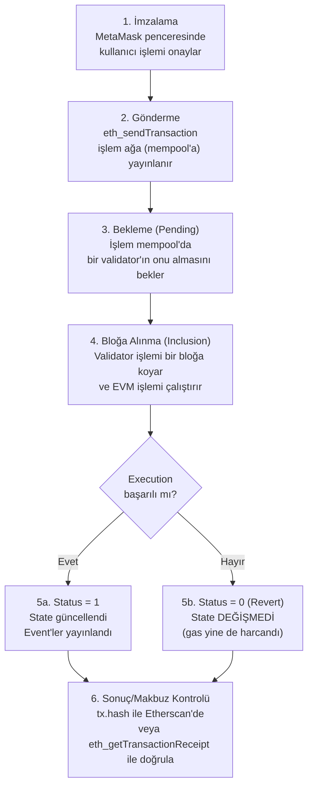

# Bölüm A: Blokzincir Temelleri ve Kavramlar (İP 01 - İP 08)

> Bu doküman, Quantum Team Blokzincir Takımı yeni üye oryantasyon iş paketinin
> İP 01'den İP 08'e kadar olan teorik sorularını yanıtlar. Her görevin
> sonunda yer alan **Benim yorumum** bölümleri, ezbere dayanmayan, kendi
> analizimi yansıtan cevaplardır.

---

## İP 01 — Blokzincir ve Ortak Kayıt

### Blokzincir, işlem, blok ve dağıtık defter nedir, nasıl ilişkilidir?

- **İşlem (transaction):** "Bir şeyi değiştir" isteğidir (ör. "A adresinden B
  adresine 1 ETH gönder" ya da "bu sözleşmede `register()` fonksiyonunu
  çağır"). Tek başına henüz hiçbir şeyi değiştirmemiştir; sadece bir
  *istektir* ve imzalanmıştır.
- **Blok:** Belirli bir zaman aralığında toplanan işlemlerin bir arada
  paketlenmiş hâlidir. Her blok, kendisinden önceki bloğun hash'ini içerir;
  bu da blokları zincir gibi birbirine bağlar (bu yüzden "blok**zincir**").
- **Dağıtık defter (distributed ledger):** Bu blok zincirinin, ağdaki
  (network) her bir node tarafından ayrı ayrı tutulan, birbirinin aynı
  kopyasıdır. "Dağıtık" kelimesi burada kritik: defter tek bir merkezi
  sunucuda değil, coğrafi olarak dağılmış yüzlerce/binlerce bağımsız
  bilgisayarda aynı anda saklanır.

İlişki şu şekilde özetlenebilir: **işlemler → bloklara paketlenir → bloklar
zincir oluşturur → bu zincirin her node'daki kopyası dağıtık defterdir.**

### Merkezi veritabanı ile blokzincir arasında kayıt kontrolü ve güven farkı

| Özellik | Merkezi Veritabanı | Blokzincir |
|---|---|---|
| Kaydı kim değiştirebilir | Veritabanı sahibi (admin) her zaman değiştirebilir | Konsensüs kuralları dışında hiç kimse geçmiş kaydı değiştiremez |
| Güvenin kaynağı | Kuruma/şirkete güven | Matematiksel/kriptografik kurallara ve çoğunluk konsensüsüne güven |
| Tek hata noktası (single point of failure) | Var (sunucu çökerse/saldırıya uğrarsa veri gider) | Yok (bir node çökse de diğerleri devam eder) |
| Denetlenebilirlik | Dışarıdan sınırlı (loglara erişim gerekir) | Herkes tüm geçmişi bağımsızca doğrulayabilir |

Kısacası: merkezi veritabanında "doğru" olan şey, yetkili tarafın söylediği
şeydir; blokzincirde "doğru" olan şey, ağın çoğunluğunun konsensüs
kurallarına göre üzerinde anlaştığı şeydir.

### Geçmiş işlem kaydı (tx history) ile güncel state nasıl ayrılır?

- **tx history:** Zincire eklenmiş, bir daha değişmeyecek (immutable) geçmiş
  olaylar listesidir — "ne olduğunun" günlüğü. Örnek: "12 Mart'ta A adresi
  `register('ahmet')` çağırdı."
- **State (güncel durum):** O geçmiş işlemlerin *sonucunda* şu anda geçerli
  olan değerdir. Örnek: "şu anda `kayitli[A] = true` ve `takmaAdlar[A] =
  'ahmet'`."

tx history asla değişmez (geçmişi silemezsiniz), ama state yeni işlemlerle
sürekli güncellenir. Bir sözleşmenin state'i, genelde tüm geçmiş işlemlerin
sırayla uygulanmasının *birikimli sonucu*dur; ama state'in kendisi her blokta
yeniden hesaplanıp saklanan "anlık görüntü"dür, tüm geçmişi tekrar
oynatmaya gerek kalmadan okunabilir.

### Bir etkinlik kayıt sisteminde blokzincir kullanmanın yararı ve ek maliyeti

**Yarar:**
- Kayıt listesi kurcalanamaz: organizatör bile sonradan "bu kişi hiç kayıt
  olmadı" diyerek kaydı silemez; herkes aynı listeyi bağımsız doğrulayabilir.
- Şeffaflık: kapasite dolana kadar kimin ne zaman kaydolduğu herkese açık ve
  denetlenebilir (yarışma/jüri açısından güven artırıcı).
- Tek bir sunucuya bağımlılık yok; organizatörün sunucusu çökse de zincirdeki
  kayıt durur değil, ağ üzerinde yaşamaya devam eder.

**Ek maliyet:**
- Her kayıt işlemi gas ücreti gerektirir (kullanıcı test ağında bile cüzdan
  kurup test ETH almak zorunda kalır — merkezi bir sistemde sadece bir form
  doldurmak yeterli olurdu).
- İşlemler blok süresi kadar gecikmeli kesinleşir (anlık değildir).
- Hatalı/kötü niyetli bir kayıt girildiğinde state'i "düzeltmek" kolay
  değildir; sözleşmede önceden böyle bir fonksiyon tanımlanmamışsa kayıt
  olduğu gibi kalır.
- Geliştirme ve test süreci (Solidity, deploy, verify, cüzdan yönetimi) basit
  bir CRUD formuna göre daha karmaşıktır.

### Benim yorumum
Kapasitesi küçük (3-50 kişi), tek bir organizasyonun düzenlediği, "kim
kazandı" tartışmasının olmadığı sıradan bir etkinlik için normal bir
veritabanı tercih ederdim: hız, sıfır kullanıcı sürtünmesi (cüzdan/gas
gerektirmeden e-posta ile kayıt) ve düzeltme kolaylığı bu ölçekte
blokzincirin sağladığı "kurcalanamazlık" avantajından daha değerlidir.
Blokzinciri, kaydın kendisinin *anlaşmazlık konusu olabileceği* (örn. bir
yarışmada "ilk kayıt olan kazanır" gibi hak iddia eden, taraflar arası güvenin
zayıf olduğu) durumlarda tercih ederim — çünkü asıl kazanç güven
ihtiyacından geliyor, teknik zorluktan değil.

---

## İP 02 — Node ve Konsensüs

### Node ve validator nedir? Her node blok üretir mi?

- **Node:** Blokzincir yazılımını çalıştıran, zincirin bir kopyasını tutan ve
  ağdaki diğer node'larla iletişim kuran herhangi bir bilgisayardır. Bir node
  sadece veriyi okuyup doğrulayabilir (full node), blok üretmek zorunda
  değildir.
- **Validator:** Ayrıca *yeni blok önerme/onaylama* yetkisine sahip özel bir
  node türüdür (PoS ağlarda belirli miktar coin "stake" etmiş olması
  gerekir). Her node bir validator değildir; çoğu node sadece zinciri
  doğrulayıp saklar, blok üretimine katılmaz.

### Konsensüs neyi sağlar? PoW ve PoS nasıl farklılaşır?

Konsensüs, birbirini tanımayan ve birbirine güvenmeyen binlerce node'un
"zincirin bir sonraki geçerli bloğu hangisi" konusunda **tek bir ortak
gerçek** üzerinde anlaşmasını sağlar; bu sayede çift harcama (double-spend)
ve çatallanma (fork) sorunları çözülür.

- **PoW (Proof of Work):** Blok üretme hakkı, yoğun hesaplama gücü (hash
  bulma yarışı) harcayana verilir. Güvenlik, "sahte zincir üretmek için
  ağın yarısından fazla hesaplama gücüne sahip olman gerekir" fikrine
  dayanır. Enerji maliyeti yüksektir (Bitcoin).
- **PoS (Proof of Stake):** Blok üretme hakkı, ağın kendi para birimini
  kilitleyen (stake eden) validator'lar arasından (genelde rastgele/ağırlıklı
  seçimle) verilir. Kötü davranan validator'ın stake'i kesilir (slashing).
  Enerji maliyeti PoW'a göre çok düşüktür (Ethereum, 2022 Merge sonrası).

### Public/private ve permissionless/permissioned kavramları

| Ağ Türü | Okuma izni | İşlem gönderme izni | Validator olma izni |
|---|---|---|---|
| **Public + Permissionless** (ör. Ethereum mainnet) | Herkese açık | Herkese açık | Herkese açık (stake/donanım şartıyla) |
| **Public + Permissioned** (ör. bazı konsorsiyum zincirleri, herkes okuyabilir) | Herkese açık | Genelde herkese açık | Sadece onaylı kuruluşlar |
| **Private + Permissioned** (ör. kurumsal Hyperledger ağı) | Sadece yetkili taraflar | Sadece yetkili taraflar | Sadece yetkili taraflar |
| **Private + Permissionless** (teoride mümkün ama pratikte nadir) | Kapalı grup | Kapalı grup içinde herkes | Kapalı grup içinde herkes |

Yani "public/private" **kimin okuyabildiğini**, "permissionless/permissioned"
ise **kimin katkıda bulunabildiğini (işlem gönderme, validator olma)**
belirler — bu iki eksen birbirinden bağımsızdır.

### Inclusion, execution success ve finality neden farklıdır?

- **Inclusion (bloğa alınma):** İşleminizin bir bloğun içine konulmuş
  olmasıdır. Bloğa alınmış olması, *başarılı çalıştığı* anlamına gelmez.
- **Execution success (başarılı çalışma):** İşlem bloğa alındıktan sonra EVM
  tarafından çalıştırılır; `require` gibi bir kontrol başarısız olursa işlem
  "revert" olur — bloğa alınmıştır (gas harcanmıştır) ama state değişmemiştir
  (`status: 0`).
- **Finality (kesinleşme):** İşleminizin bulunduğu bloğun, zincirin geri
  alınamaz (geri döndürülemeyecek derecede güvenli) bir parçası haline
  gelmesidir. Bir blok ilk eklendiğinde teorik olarak hâlâ bir "reorg" ile
  değişebilir; belirli sayıda blok onayından sonra (Ethereum'da "finalized"
  etiketine ulaşınca) pratik olarak geri alınamaz kabul edilir.

Bu üçü ayrı ayrı gerçekleşir: bir işlem bloğa alınabilir, ama execution'ı
başarısız (revert) olabilir; execution başarılı olabilir ama blok henüz
finalize olmamış olabilir (teorik olarak reorg riski taşır).

### Benim yorumum
Tek bir node kapanınca ağın durup durmayacağı, o node'un **validator** olup
olmadığına ve ağdaki toplam validator/node sayısına bağlıdır. Sıradan bir
"full node" (sadece okuyan/doğrulayan) kapanırsa ağ hiç fark etmez — zaten
binlerce kopyadan biri daha vardı. Ama ağın validator setinin büyük bir kısmı
(PoS'ta "oy gücünün" >1/3'ü gibi kritik eşikler) aynı anda çevrimdışı
kalırsa, ağ blok üretemeyebilir veya finality'ye ulaşamayabilir. Yani kritik
olan "kaç node var" değil, "kapanan node(lar) toplam doğrulama/stake gücünün
ne kadarını temsil ediyor" sorusudur.

---

## İP 03 — Kriptografi ve Cüzdan

### Hash, şifreleme ve dijital imza hangi farklı amaçlarla kullanılır?

- **Hash (keccak256/SHA-256):** Herhangi bir veriyi sabit uzunlukta, **geri
  döndürülemez** bir özet değere çevirir. Amaç: veri bütünlüğü kontrolü
  ("bu veri değişti mi?") ve benzersiz kimlik üretimi (adres türetme,
  blok/işlem hash'i). Hash'ten orijinal veriye geri dönülemez.
- **Şifreleme (encryption):** Veriyi, doğru anahtara sahip olmayanın
  okuyamayacağı hale getirir, ama doğru anahtarla **geri çevrilebilir**
  (decrypt edilebilir). Amaç: gizlilik (confidentiality).
- **Dijital imza (ECDSA):** Bir mesajın, belirli bir private key'in sahibi
  tarafından onaylandığını, kimsenin taklit edemeyeceği şekilde kanıtlar.
  Amaç: kimlik doğrulama (authentication) ve inkâr edilemezlik
  (non-repudiation) — gizlilik sağlamaz, ama "bunu ben imzaladım" garantisi
  verir.

Üçü de blokzincirde birlikte kullanılır ama amaçları tamamen ayrıdır: hash
bütünlük, şifreleme gizlilik, imza ise kimlik/onay içindir.

### Private key, public key, adres, mnemonic, seed arasındaki ilişki

```
Entropi (rastgele sayı)
   │  (BIP39: checksum ekle, kelimelere böl)
   ▼
Mnemonic (12 kelime)
   │  (BIP39: PBKDF2-HMAC-SHA512, 2048 iterasyon)
   ▼
Seed (512-bit)
   │  (BIP32: HMAC-SHA512 ile master key türetimi + BIP44 yol türetimi)
   ▼
Private Key (256-bit) ──(secp256k1 eliptik eğri çarpımı)──▶ Public Key (512-bit)
                                                                 │ (Keccak-256 hash, son 20 byte)
                                                                 ▼
                                                             Ethereum Adresi (160-bit)
```

Bu zincirde her ok **tek yönlüdür**: entropiden adrese gidebilirsiniz ama
adresten private key'e, private key'den mnemonic'e geri dönemezsiniz (hash
ve eliptik eğri işlemleri matematiksel olarak geri döndürülemez).

### Entropi, checksum, BIP39/BIP32/BIP44 hangi aşamalarla ilgilidir?

- **Entropi:** Sürecin başlangıç noktası olan, kriptografik olarak güvenli
  rastgele bitlerdir (128 bit = 16 byte). Tüm güvenlik buradan başlar: zayıf
  rastgelelik, zincirin sonunu ne kadar güçlü yaparsanız yapın her şeyi
  kırılgan hale getirir.
- **Checksum:** Entropinin SHA-256 hash'inin ilk 4 bitidir; entropiye
  eklenerek (128 + 4 = 132 bit) mnemonic'in bir yazım hatasını (geçersiz
  kelime kombinasyonunu) yakalamaya yarar. **BIP39** standardı bu
  entropi→checksum→mnemonic→seed sürecini tanımlar.
- **BIP32:** Seed'ten "hiyerarşik deterministik" (HD) bir anahtar ağacı
  türetme yöntemini tanımlar (master key, child key'ler, türetme yolları).
- **BIP44:** BIP32'nin üzerine, türetme yollarının anlamını standartlaştırır:
  `m / amaç' / coin_türü' / hesap' / değişim / adres_indeksi`
  (Ethereum için `m/44'/60'/0'/0/0`).

### Cüzdan uygulaması ile hesap aynı şey midir?

Hayır. **Hesap**, zincirde var olan bir adrestir (ve ona bağlı anahtar
çiftidir) — zincirin kendisine ait bir kavramdır. **Cüzdan uygulaması**
(MetaMask gibi) ise sadece bu anahtarları saklayan, imzalamayı
kolaylaştıran bir **arayüz/yazılımdır**. Aynı hesabı birden fazla cüzdan
uygulamasında (MetaMask, Rabby, hardware wallet) aynı mnemonic ile
içe aktarabilirsiniz; hesap uygulamadan bağımsız, zincirde/matematikte var
olan bir şeydir.

Adresi paylaşmak ile private key'i paylaşmak **taban tabana zıttır**: adres,
genel/kamuya açık bir "banka IBAN'ı" gibidir — paylaşılması sadece "buraya
para/işlem gönder" anlamına gelir, hiçbir risk taşımaz. Private key ise
"banka hesabınızın şifresi + imza yetkisi"dir — paylaşıldığı anda o
hesaptaki her şeyin kontrolü karşı tarafa geçer. Adres paylaşımının tek riski
**mahremiyettir** (privacy): zincir herkese açık olduğu için adresinizi
paylaştığınız kişi (ve teorik olarak herkes), o adresin geçmiş/gelecek tüm
işlemlerini, bakiyesini ve etkileşimde bulunduğu sözleşmeleri görebilir —
finansal gizlilik anlamında gerçek dünyadaki "banka hesap dökümünüzü
paylaşmaya" daha yakındır.

### Benim yorumum
Cüzdan uygulamasının silinmesi ile mnemonic/private key'in kaybolması çok
farklı önem derecelerine sahip olaylardır. Uygulama silinirse ama
mnemonic/private key elimde (kağıda yazılı, başka bir yerde yedekli) ise,
herhangi bir cüzdan uygulamasına "içe aktar" (import) diyerek hesabıma
dakikalar içinde geri dönebilirim — hiçbir kayıp yoktur, çünkü hesap
uygulamaya değil, kriptografik anahtara bağlıdır. Ama mnemonic/private key
kaybolursa (ve yedeği yoksa) hesap matematiksel olarak geri getirilemez hale
gelir — "şifremi unuttum" diyip sıfırlayabileceğiniz bir müşteri hizmetleri
yoktur; o adresteki her şey kalıcı olarak erişilemez kalır. Bu yüzden asıl
kritik yedek, uygulama değil, mnemonic/private key'in kendisidir.

---

## İP 04 — Bitcoin, Ethereum ve Token

### Bitcoin ve Ethereum'un temel amaçları ve programlanabilirliği

- **Bitcoin:** Amacı, merkezi bir otoriteye gerek kalmadan değer transferi
  (dijital nakit) yapmaktır. **UTXO modeli** kullanır: "hesap bakiyesi" diye
  bir kavram yoktur; harcanmamış çıktılar (unspent transaction outputs)
  biriktirilip harcanır. **Script** adında kısıtlı, Turing-complete OLMAYAN
  bir dille basit koşullar (ör. "bu 2 imza da gerekli") tanımlanabilir.
- **Ethereum:** Amacı, genel amaçlı, programlanabilir bir "dünya bilgisayarı"
  olmaktır. **Account Model** kullanır: her adresin (EOA veya sözleşme) bir
  bakiyesi/state'i vardır. **EVM (Ethereum Virtual Machine)** Turing-complete
  bir yürütme ortamıdır; Solidity gibi dillerle yazılan karmaşık mantık
  (akıllı sözleşmeler) çalıştırılabilir.

Kısaca: Bitcoin "programlanabilir para", Ethereum "programlanabilir
bilgisayar" hedefiyle tasarlanmıştır.

### Native varlık ve token nedir? ETH ve USDC örneği

- **Native varlık:** Zincirin kendi protokolünün parçası olan, gas
  ücretlerini ödemek için kullanılan temel birimdir (Ethereum'da **ETH**).
  Bir sözleşmeye ihtiyaç duymaz; EVM'in çekirdeğinde tanımlıdır.
- **Token:** Zincirin native varlığı DEĞİL, bir **akıllı sözleşme**
  tarafından tanımlanan, kendi bakiye/transfer mantığına sahip varlıktır
  (Ethereum'da **USDC**, bir ERC-20 sözleşmesidir). Token'ı transfer etmek
  için o sözleşmenin `transfer()` fonksiyonu çağrılır; ama bu çağrıyı
  göndermek için bile gas ücreti **native varlıkla (ETH)** ödenir.

### Stablecoin, NFT (ERC-721) ve ERC-20 kavramları

- **ERC-20:** Birbirinin aynı (fungible), bölünebilir token'lar için
  standart arayüz (transfer, balanceOf, approve...). USDC, USDT gibi
  stablecoin'ler ve çoğu "coin" projesi ERC-20'dir.
- **Stablecoin:** Değeri bir referans varlığa (genelde USD) sabitlenmeye
  çalışan bir token türüdür (USDC gibi) — teknik olarak genelde bir ERC-20
  sözleşmesidir, "stablecoin" onun ekonomik amacını tanımlar.
- **NFT (ERC-721):** Her biri **benzersiz** (non-fungible) olan, birbirinin
  yerine geçemeyen token'lar için standart (her NFT'nin kendine özgü bir
  `tokenId`'si vardır). Dijital sanat, kimlik kanıtı, bilet gibi "bu belirli
  öğe" temsillerinde kullanılır.

### Mainnet ve testnet neden ayrılır?

**Mainnet**, gerçek ekonomik değere sahip varlıkların bulunduğu, canlı
ağdır — hatalar gerçek para kaybına yol açar. **Testnet** (Sepolia gibi),
geliştiricilerin kod/sözleşmelerini **gerçek para riski olmadan** test
edebilmesi için var olan, mainnet'e paralel ama ayrı bir ağdır.

Test ETH ve test USDC **hiçbir gerçek ekonomik değer taşımaz** — borsada
satılamaz, gerçek mal/hizmetle değiştirilemez; faucet'lerden (musluk)
bedava dağıtılır. Mainnet'teki ETH/USDC ile testnet'teki aynı isimli
varlıklar, kod/arayüz olarak benzese de **tamamen farklı, izole ağlarda**
yaşar ve ekonomik olarak birbiriyle hiç ilişkili değildir.

### Benim yorumum
Etkinliğe giriş hakkını temsil etmek için mutlaka bir token (ERC-20/ERC-721)
gerekmez. Bizim `EtkinlikKayit` sözleşmemizde yaptığımız gibi basit bir
`mapping(address => bool)` ile de "bu adres kayıtlı/girişi onaylı" bilgisi
aynı güvenlik garantisiyle (sadece sözleşme kuralları değiştirebilir)
saklanabilir — token'a özgü olan tek şey, bu hakkın **başka bir cüzdana
devredilebilir/satılabilir** olmasıdır (NFT bilet gibi). Bizim senaryomuzda
"bu kayıt kime ait, devredilebilir mi" sorusu önemli değil (kayıt kişiye
özel ve devredilemez olmalı), bu yüzden mapping/state çözümü hem daha basit
hem de amaca daha uygun; token'ı, hakkın ikincil bir piyasada
alınıp-satılması gerektiğinde tercih ederdim.

---

## İP 05 — Akıllı Sözleşme ve ABI

### Akıllı sözleşme, EVM ve state nedir?

- **Akıllı sözleşme:** Ethereum adresinde yaşayan, önceden yazılmış kurallara
  göre otomatik çalışan koddur. "Akıllı" olması yapay zeka anlamında değil,
  "önceden tanımlanmış mantığı insan araya girmeden uygulaması" anlamındadır.
- **EVM (Ethereum Virtual Machine):** Bu kodu çalıştıran, her node üzerinde
  aynı şekilde işleyen sanal makinedir; tüm node'lar aynı EVM kurallarıyla
  aynı işlemi çalıştırdığında aynı sonuca ulaşır (determinizm, konsensüsün
  temelidir).
- **State:** Sözleşmenin storage'ında tutulan, zaman içinde işlemlerle
  değişen verilerdir (bizim örneğimizde `takmaAdlar`, `kayitliMi`,
  `toplamKayitSayisi` gibi mapping/değişkenler).

### Kaynak kod, derleme ve bytecode ilişkisi; deploy ne yapar?

Solidity ile yazılan **kaynak kod**, insan tarafından okunabilir mantığı
içerir. **Derleme (compilation)**, bu kodu EVM'in anlayabileceği, 0-1'lere
indirgenmiş **bytecode**'a çevirir (bizim projede `npx hardhat compile`
adımı budur). **Deploy**, bu bytecode'u içeren özel bir işlem göndererek
EVM'e "bu kodu çalıştıracak yeni bir adres oluştur" demektir; işlem
onaylandığında sözleşmeye kalıcı bir adres atanır ve bytecode o adreste
saklanır.

### ABI ne işe yarar? Ne zaman elde edilir?

**ABI (Application Binary Interface)**, bir sözleşmenin hangi fonksiyonlara
sahip olduğunu, bu fonksiyonların hangi parametreleri aldığını/döndürdüğünü
ve hangi event'leri yayınladığını tanımlayan bir **JSON şemasıdır**. Bytecode
sadece ham makine kodu olduğu için, dışarıdan (frontend, Remix, Etherscan)
bir fonksiyonu "isimle" çağırabilmek için ABI gereklidir — ABI, derleme
sırasında kaynak koddan otomatik üretilir (bytecode ile birlikte).

Bir sözleşmeye bağlanmak için sadece **adres** yeterli değildir; adres
dışında **ABI**'ye de ihtiyaç vardır (Remix'te "At Address" ile bağlanırken
hem adresi hem de hangi sözleşmenin ABI'sini kullanacağınızı seçersiniz).

### View/pure call ile state değiştiren transaction nasıl ayrılır?

- **`view`/`pure` çağrı (`eth_call`):** State'i okur (view) veya hiçbir
  state'e dokunmaz (pure); gas ücreti gerektirmez (yerel olarak simüle
  edilir), imza gerektirmez, anlık sonuç döner.
- **Transaction (`eth_sendTransaction`):** State'i değiştirir; imzalanması,
  ağa yayınlanması, bir madenci/validator tarafından bloğa alınması gerekir;
  gas ücreti öder ve sonucu (receipt) beklemek gerekir.

### Verify etmek neyi doğrular? Audit ile aynı şey midir?

**Verify (Etherscan üzerinde kaynak kodu doğrulama)**, deploy edilmiş
bytecode'un, sağladığınız Solidity kaynak kodundan **gerçekten derlendiğini**
kanıtlar — yani "bu adreste çalışan kod, gördüğünüz bu kaynak koddur"
garantisi verir. **Audit** ise tamamen farklı bir şeydir: bağımsız
güvenlik uzmanlarının kodu *güvenlik açıkları* için incelemesidir. Verify
edilmiş bir sözleşme hâlâ güvenlik açığı içerebilir — verify sadece
şeffaflık sağlar, güvenliği garanti etmez.

### Benim yorumum
Aynı kaynak kod iki farklı adrese deploy edildiğinde kayıtları (state)
ayrı olur, çünkü **bytecode (mantık) ile storage (veri) EVM'de birbirinden
ayrı saklanır**. Her deploy işlemi, aynı mantığı çalıştıracak ama kendine ait,
sıfırdan başlayan **yeni bir storage alanı** olan yeni bir adres oluşturur.
Bu, aynı sınıfın (class) iki farklı nesnesini (instance) oluşturmaya
benzer: kod (metodlar) paylaşılır gibi görünse de her instance'ın kendi
alan (field) değerleri vardır. Bizim projede de `QuantumKayit`'in takımın
adresindeki hâli ile kendi deploy ettiğimiz kopyası, aynı ABI/mantığa sahip
olsa da kayıt listeleri tamamen bağımsızdır.

---

## İP 06 — RPC, Explorer ve Event

### RPC ve RPC endpoint nedir? Node ile RPC sağlayıcı ilişkisi

**RPC (JSON-RPC)**, dışarıdan bir uygulamanın (cüzdan, script, frontend) bir
node ile "zincire soru sor / işlem gönder" şeklinde iletişim kurduğu
standart protokoldür (`eth_call`, `eth_sendTransaction`, `eth_getBalance`
gibi metodlar). **RPC endpoint**, bu isteklerin gönderildiği URL'dir.

Kendi node'unuzu çalıştırmak donanım/bakım gerektirdiği için, **Infura**,
**Alchemy** gibi hizmet sağlayıcılar, kendi node'larını işletip size bir
RPC endpoint URL'si (ücretli/ücretsiz) sunar — siz node işletmek zorunda
kalmadan zincirle konuşursunuz. **Public RPC** ise herkese açık, genelde
daha az güvenilir/hız garantisi olmayan ücretsiz endpoint'lerdir.

### Block explorer nedir? Explorer/RPC kapanması ağın durduğu anlamına mı gelir?

**Block explorer** (Etherscan gibi), zincirdeki blokları/işlemleri/
sözleşmeleri insanın okuyabileceği bir web arayüzünde gösteren bir **üçüncü
parti hizmettir** — zincirin kendisinin bir parçası değildir, sadece RPC
üzerinden veri okuyup güzel bir arayüzde sunar.

**Hayır**, Etherscan veya kullandığınız bir RPC sağlayıcı kapansa bile ağın
kendisi durmaz: zincir, dünya çapında binlerce bağımsız node tarafından
çalıştırılır; Etherscan sadece bu node'lardan birini (veya birkaçını)
okuyup görselleştiren bir "pencere"dir. Pencere kırılsa da oda (ağ) yerinde
durur — başka bir RPC sağlayıcıya veya başka bir explorer'a geçerek aynı
zincir verisine erişebilirsiniz.

### Event/log ile güncel state nasıl ayrılır? Indexer ne işe yarar?

**Event/log**, bir işlem sırasında "bu da oldu" diye zincire yazılan,
**değiştirilemeyen tarihsel kayıtlardır** (bizim `Registered`,
`KayitYapildi`, `GirisYapildi` event'lerimiz gibi) — ama bunlar sözleşmenin
*storage*'ının bir parçası değildir, sadece günlüktür; sözleşme kodu
event'leri geri okuyamaz. **Güncel state** ise storage'da tutulan, her an
sorgulanabilen "şu anki" değerdir.

Binlerce event'i tek tek tarayıp "şu ana kadar kim kayıt oldu" sorusuna
cevap bulmak yavaştır. **Indexer** (The Graph gibi), tüm geçmiş event'leri
önceden tarayıp özel, hızlı sorgulanabilir bir veritabanına dönüştüren bir
hizmettir — "zincirdeki ham logları, uygulamanın kolayca sorgulayabileceği
yapılandırılmış veriye çeviren" bir ara katmandır.

### Benim yorumum
Explorer olmadan bir kaydı kontrol etmek için **doğrudan RPC endpoint'ine
`eth_call` göndererek** sözleşmenin `kayitliMi(adres)` gibi bir view
fonksiyonunu çağırırdım — bunu `cast call <adres> "kayitliMi(address)"
<adres> --rpc-url <url>` (Foundry) gibi bir komut satırı aracıyla ya da
kendi yazacağım küçük bir `ethers.js` script'iyle yapabilirim. Alternatif
olarak işlem hash'im varsa `eth_getTransactionReceipt` ile makbuzu çekip
`status` alanını ve `logs` içindeki event verisini manuel olarak okuyabilirim.
Bu, Explorer'ın arka planda zaten yaptığı işin ta kendisidir; sadece
görselleştirme katmanını atlayıp doğrudan protokol seviyesinde sorguluyoruz.

---

## İP 07 — Bir İşlemin Yolculuğu

### eth_requestAccounts, personal_sign/EIP-712, eth_sendTransaction farkı

- **`eth_requestAccounts`:** Sitenin, cüzdanınızdaki hesap adres(ler)ine
  **erişim izni** istemesidir. Hiçbir imza atılmaz, hiçbir ücret ödenmez;
  sadece "bu site artık adresimi görebilir" onayı verilir.
- **`personal_sign` / EIP-712 (mesaj imzalama):** Zincire HİÇBİR ŞEY
  gönderilmez, gas ödenmez. Sadece bir mesajı private key'inizle imzalayıp
  "bunu ben onayladım" kanıtı üretirsiniz (ör. bir siteye giriş yapmak için
  "kimlik kanıtlama" amaçlı kullanılır).
- **`eth_sendTransaction`:** Zincire gerçekten bir işlem gönderir, state
  değiştirebilir, gas ücreti gerektirir ve bloğa alınıp çalıştırılması
  gerekir.

Üçü de imza içerebilir ama sonuçları tamamen farklıdır: ilki sadece izin,
ikincisi zincire dokunmayan bir kanıt, üçüncüsü gerçek bir zincir
işlemidir.

### Gas limit, gas used, ücret, nonce, chain ID

- **Gas limit:** Kullanıcının bir işlem için "en fazla bu kadar hesaplama
  adımına izin veriyorum" dediği üst sınırdır; işlem bunu aşarsa
  "out of gas" hatasıyla revert olur.
- **Gas used:** İşlemin **gerçekte** harcadığı gas miktarıdır (genelde gas
  limitinden azdır).
- **İşlem ücreti (base fee + priority fee):** Ethereum'da (EIP-1559 sonrası)
  ücret, ağın o anki yoğunluğuna göre otomatik ayarlanan **base fee** (yanan,
  hiçbir madenciye gitmeyen kısım) ile kullanıcının validator'a "beni öne
  al" diye verdiği ekstra **priority fee (tip)**'in toplamından oluşur.
  Toplam ücret ≈ `gas used × (base fee + priority fee)`.
- **Nonce:** Bir adresin gönderdiği işlemlerin **sırasını** takip eden
  sayaçtır (0'dan başlar, her işlemde 1 artar). Aynı nonce'u iki kez
  kullanmaya çalışmak (veya sıra atlamak) işlemi geçersiz/beklemede
  bırakır — bu da "çift harcama"ya karşı önemli bir korumadır.
- **Chain ID:** Hangi ağda (mainnet mi, Sepolia mı, başka bir zincir mi)
  işlem yapıldığını belirten sayıdır (Sepolia: `11155111`). Bu olmadan aynı
  private key ile imzalanan bir işlem yanlışlıkla başka bir ağda da geçerli
  sayılabilirdi (replay attack riski); chain ID bunu önler.

### Txid, sözleşme adresi, block hash neyi tanımlar?

- **Transaction hash (txid):** Bir işlemin **benzersiz kimliğidir** —
  işlemin tüm alanlarının hash'idir, Explorer'da arama yapmak için
  kullanılır.
- **Sözleşme adresi:** Bir deploy işleminin sonucunda EVM tarafından
  (gönderenin adresi + nonce'dan deterministik olarak) üretilen, yeni
  sözleşmenin yaşayacağı adrestir.
- **Block hash:** Bir bloğun içeriğinin (önceki blok hash'i dahil) tüm
  özetidir; bloğun benzersiz kimliğidir ve bir sonraki bloğun içinde
  referans olarak kullanılır (zinciri oluşturan bağlantı budur).

### Pending, receipt, status; tx hash neden tek başına kanıt değildir?

- **Pending:** İşlem imzalanıp ağa (mempool'a) gönderilmiş ama henüz bir
  bloğa alınmamış durumdur.
- **Receipt (makbuz):** İşlem bir bloğa alınıp ÇALIŞTIRILDIKTAN SONRA
  üretilen sonuç belgesidir; `status`, `gasUsed`, `logs` gibi alanları
  içerir.
- **Status:** `1` = işlem başarıyla çalıştı (state değişti); `0` = işlem
  bloğa alındı ama çalışması **revert** oldu (state değişmedi, gas yine de
  harcandı).

Bir tx hash, sadece "bu kimlikte bir işlem imzalandı/gönderildi" anlamına
gelir — **henüz sonucunu söylemez**. Hash'in var olması, işlemin bloğa
alınıp alınmadığını, alındıysa başarılı mı yoksa revert mi olduğunu
garantilemez; bu bilgi için **receipt'in `status` alanına** bakmak gerekir.
Bu yüzden "işlem hash'im var, demek ki başarılı" demek yanlıştır.

### İşlemin Yolculuğu — Akış Şeması



```text
ASCII Akış Şeması:

[İmzalama] --> [Gönderme] --> [Pending/Mempool] --> [Bloğa Alınma]
                                                          |
                                                 EVM işlemi çalıştırır
                                                          |
                                          +---------------+---------------+
                                          |                               |
                                   status = 1 (başarılı)         status = 0 (revert)
                                   state güncellendi              state değişmedi
                                          |                               |
                                          +---------------+---------------+
                                                          |
                                             [Makbuz / Etherscan Kontrolü]

>>> KENDİ TX HASH'İM (İP 16'da QuantumKayit'e register("emresert") çağrısı):
    Tx Hash: 0xc14274a0822a6ab814e4b7fcf8a4cc3afdd949b2ac8b03f80947a053ab88c158
    Etherscan Linki: https://sepolia.etherscan.io/tx/0xc14274a0822a6ab814e4b7fcf8a4cc3afdd949b2ac8b03f80947a053ab88c158
    Gözlemlenen Status: [x] 1 (Başarılı)   [ ] 0 (Revert)
    (Ayrıntılı analiz için bkz. docs/Uygulama-Kayitlari-ve-Kanitlar.md → İP 17)
```

### Benim yorumum
"İşlem başarısız (reverted)" ile "sonucunu öğrenemedim (timeout/RPC hatası)"
birbirinden tamamen farklıdır çünkü ilki **zincirin kendisinin verdiği kesin
bir cevaptır** (işlem bloğa alındı, EVM çalıştırdı, `require` koşulu
tutmadı, status=0 olarak kayda geçti — bu artık değişmeyecek bir gerçektir),
ikincisi ise **benim bilgisayarımla zincir arasındaki iletişimin
koptuğu** bir durumdur; işlemin zincirdeki gerçek kaderi hâlâ belirsizdir —
başarılı da olabilir, revert de olabilir, hatta hâlâ mempool'da bekliyor da
olabilir. Bu ayrımı anlamadan "RPC hata verdi, demek ki işlem başarısız
oldu" sonucuna atlamak, aynı işlemi tekrar göndererek yanlışlıkla **iki kez**
kayıt/giriş denemesine (ve beklenmeyen davranışlara) yol açabilir — bu
yüzden Modül 2'deki arayüzde bu iki durumu kasıtlı olarak ayrı mesajlarla
gösteriyoruz ve belirsizlik durumunda asla otomatik yeniden gönderim
yapmıyoruz.

---

## İP 08 — Ekosistemi Tanı

### Temel kavramlar

- **Web3:** Kullanıcıların verilerinin/varlıklarının merkezi bir şirkete
  değil, kendi kriptografik anahtarlarına bağlı olduğu, blokzincir tabanlı
  internet uygulamaları vizyonudur.
- **L1/L2:** **L1 (Layer 1)**, Ethereum gibi temel/ana zincirdir. **L2
  (Layer 2)**, L1'in güvenliğinden yararlanarak ama işlemleri L1 dışında
  (daha hızlı/ucuz) işleyip sonucu L1'e "özetleyerek" kaydeden ek
  katmandır (ör. Arbitrum, Optimism — Rollup'lar).
- **DeFi (Decentralized Finance):** Banka/aracı olmadan borç verme, takas,
  faiz kazanma gibi finansal işlemleri akıllı sözleşmelerle yapan uygulama
  kategorisidir (Aave, Uniswap).
- **DAO (Decentralized Autonomous Organization):** Kararların (bütçe,
  kurallar) merkezi bir yönetim kurulu yerine, token sahiplerinin oylamasıyla
  ve akıllı sözleşmelerle yürütüldüğü organizasyon modelidir.
- **Oracle:** Zincirin kendisi internete erişemediği için, zincir dışı
  (off-chain) gerçek dünya verisini (döviz kuru, hava durumu, spor sonucu)
  güvenilir şekilde zincire taşıyan hizmettir (Chainlink).
- **Bridge (köprü):** Bir varlığı/veriyi bir zincirden başka bir zincire
  taşımayı sağlayan protokoldür (ör. Ethereum'dan Polygon'a token taşımak).
- **Zero-Knowledge Proof (ZK):** Bir bilginin *doğru olduğunu*, bilginin
  **kendisini hiç ifşa etmeden** kanıtlama yöntemidir.

### DID/ENS, RWA, DePIN için gerçek kullanım örnekleri

- **DID/ENS (Dijital Kimlik):** **ENS (Ethereum Name Service)**,
  `0x81dd...` gibi okunması zor adresleri `isim.eth` gibi okunabilir isimlere
  çevirir — "blokzincirin DNS'i" gibi düşünülebilir; aynı zamanda bu isim
  altında profil/sosyal bilgiler de taşınabilir (merkezi olmayan dijital
  kimlik).
- **RWA (Real World Assets):** Gerçek dünyadaki bir varlığın (gayrimenkul,
  devlet tahvili, altın) sahipliğinin/payının bir token ile zincirde temsil
  edilmesidir — ör. bir tahvil fonunun paylarının tokenize edilip 7/24,
  küçük parçalar halinde alınıp satılabilmesi.
- **DePIN (Decentralized Physical Infrastructure Networks):** Fiziksel
  altyapıyı (kablosuz ağ anten, GPU hesaplama gücü, hava durumu sensörü)
  kuran/işleten kişilerin, kullanımları karşılığında token ile
  ödüllendirildiği ağlardır (ör. bir kablosuz hotspot ağı kuran kişilerin
  ağ kullanımı karşılığında token kazanması).

### ZK ile ne kanıtlanır, hangi bilgi saklanabilir?

Basit örnek: "18 yaşından büyüğüm" bilgisini, **doğum tarihimi hiç
açıklamadan** bir ZK kanıtıyla ispatlayabilirim — doğrulayan taraf sadece
"evet, bu kişi 18 yaşından büyük" sonucunu görür, gerçek doğum tarihini
asla öğrenmez. Saklanan bilgi: doğum tarihinin kendisi. Kanıtlanan bilgi:
"doğum tarihinden hesaplanan yaş ≥ 18" önermesinin doğruluğu.

**"ZK kullanılıyor" ifadesi, tüm işlemlerin gizli olduğu anlamına GELMEZ.**
Burada kritik bir ayrım var:
- **ZK-Rollup (Validity Proof amaçlı):** ZK burada **gizlilik için değil,
  ölçeklenebilirlik/doğrulama için** kullanılır — binlerce işlemin doğru
  işlendiğini, her birini tekrar çalıştırmadan tek bir küçük kanıtla
  ispatlamaya yarar. İşlemlerin içeriği genelde hâlâ herkese açıktır
  (Arbitrum, zkSync gibi çoğu L2'nin temel kullanım amacı budur).
- **ZK-Privacy (gizlilik amaçlı):** ZK burada gerçekten **işlem detaylarını
  gizlemek** için kullanılır (ör. Tornado Cash, Zcash gibi gizlilik odaklı
  protokoller).

Yani "ZK" bir araçtır; *hangi amaçla* kullanıldığı projeye göre değişir —
"ZK var" demek otomatik olarak "gizlilik var" anlamına gelmez.

### Benim yorumum
En çok **Oracle ve ZK-Rollup** alanlarını daha derinlemesine öğrenmek
isterim, çünkü ikisi de "zincirin kendi başına yapamadığı ama gerçek
uygulamalar için zorunlu olan" sorunları çözüyor: Oracle zincirin dış
dünyayla konuşmasını sağlıyor, ZK-Rollup ise zincirin ölçeklenme sorununu
(her node'un her işlemi tekrar çalıştırması gerekmemesi) çözüyor. İkisi de
hem teorik olarak ilginç (kriptografi + dağıtık sistemler kesişimi) hem de
TEKNOFEST gibi bir yarışmada "gerçek dünya problemini çözen" bir proje
üretmek için kritik pratik araçlar.

---

*(İP 09 ve İP 10, ayrı dosyada: [Bolum-A-IP09-IP10-Proje-ve-Yarisma.md](Bolum-A-IP09-IP10-Proje-ve-Yarisma.md))*
